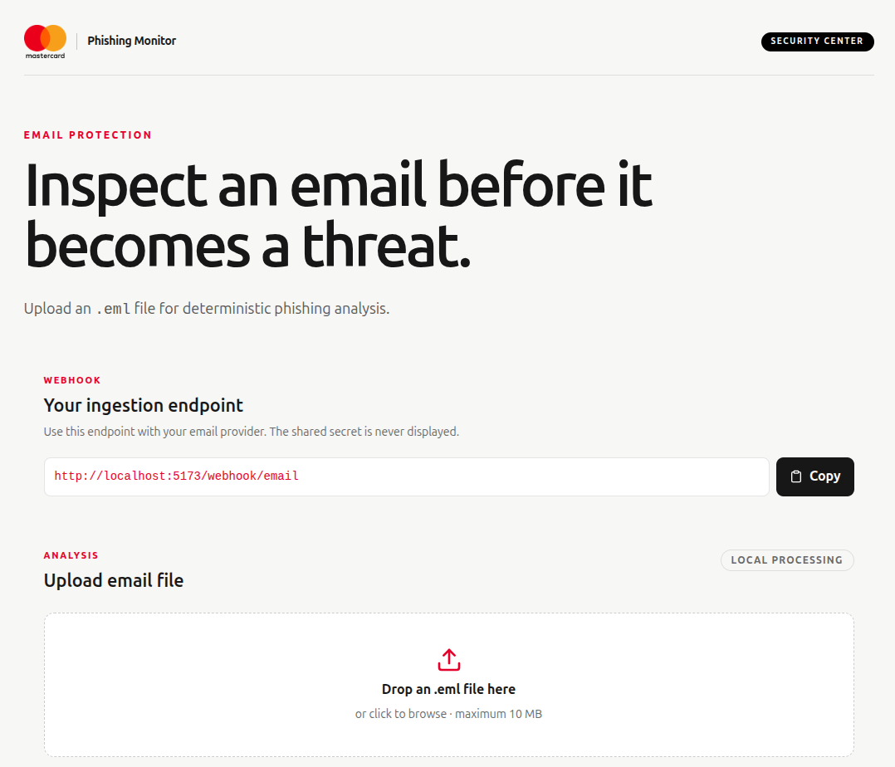
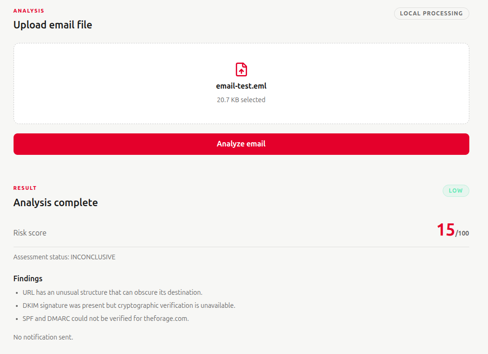

# Phishing Monitor


Mastercard is a global payments technology company that connects consumers,
financial institutions, merchants, governments, and businesses through digital
payment networks and related technology. This project is an independent
phishing-monitoring MVP inspired by the need for strong trust and security in
digital commerce. It is not an official Mastercard product, service, or security tool, and it does not process payment-card data.

## Mastercard and cybersecurity

Security is fundamental to payment ecosystems because an attacker can use a
single compromised account, mailbox, merchant, or endpoint to reach many other
people and organizations. Mastercard's cybersecurity work spans payment
security, fraud prevention, identity and authentication, cyber intelligence,
threat intelligence, and technology risk management.

Relevant Mastercard capabilities and initiatives include:

- **Cyber & Intelligence:** Mastercard combines cyber intelligence, fraud
  signals, identity data, and payment expertise to help organizations detect
  and respond to threats.
- **Threat intelligence:** Threat research and intelligence can help identify
  malicious infrastructure, campaigns, indicators of compromise, and emerging
  attack patterns.
- **Identity and authentication:** Identity verification, account protection,
  tokenization, and risk-based decisions help reduce unauthorized access.
- **Fraud and scam prevention:** Behavioral and transaction signals can help
  distinguish legitimate activity from account takeover, social engineering,
  payment fraud, and scams.
- **Third-party and digital risk:** Services such as RiskRecon support
  visibility into security weaknesses across an organization's external
  digital footprint and supply chain.

Phishing is closely related to each of these areas. A phishing message can
imitate a trusted brand, trick a user into disclosing credentials, redirect a
user to a fake login page, install malware, or begin an account-takeover and
payment-fraud sequence. Effective defense therefore needs more than a
brand-name match. It should combine message parsing, sender and authentication
evidence, URL inspection, threat intelligence, domain and DNS context, user
reporting, and clear response procedures.

Phishing Monitor demonstrates that defensive workflow at email-ingestion
level. It accepts a message, preserves the available evidence, applies
explainable deterministic rules, assigns a risk score, and returns findings
without opening links or executing attachments. It is a learning and
engineering project, not a claim that the MVP provides Mastercard's production
security coverage or detection accuracy.

## What this project does

Phishing Monitor receives email events through an HTTP API and analyzes the
original RFC 5322/MIME message with traditional security techniques. It does
not use artificial intelligence, machine learning, LLMs, or generative AI for
classification.

The current workflow:

1. Receive a provider webhook or a local `.eml` upload.
2. Authenticate the request with `X-Webhook-Secret` when configured.
3. Enforce the configured request and email-size limits.
4. Parse headers, sender, recipient, subject, message ID, body parts, URLs,
   and attachment names.
5. Inspect URLs without navigating to them or following redirects.
6. Record available DKIM and DNS/SPF/DMARC evidence.
7. Collect deduplicated findings from specialized analyzers.
8. Calculate a deterministic score from `0` to `100`.
9. Assign `LOW`, `MEDIUM`, `HIGH`, or `CRITICAL` risk.
10. Mark incomplete verification as `INCONCLUSIVE` instead of treating missing
    evidence as proof of phishing.
11. Return the result directly to the browser for local analysis.
12. Optionally send an alert to a configured, trusted recipient for provider
    webhook events above the notification threshold.

## Main features

### MIME email parsing

The parser uses Python's standard `email` package. It handles plain-text and
HTML bodies, multipart messages, common character encodings, malformed input,
message IDs, header extraction, URL extraction, and attachment names. It never
executes an attachment and does not include the full original message in an
alert.

### Deterministic URL analysis

The URL analyzer can identify:

- Direct IP-address hosts.
- Loopback, private, link-local, reserved, and other restricted destinations.
- Punycode and potentially confusing internationalized domains.
- Unusual URL structures, including user-information components and very long
  URLs.
- Possible typosquatting against configured trusted domains.
- Exact matches against explicitly configured threat indicators.

The analyzer performs no requests to extracted URLs. HTTPS is not treated as
proof that a destination is safe. Domain similarity is a heuristic warning,
not proof that a URL is malicious.

### Authentication and DNS evidence

The application represents missing or unavailable verification explicitly.
Missing DKIM is not automatically classified as phishing. SPF and DMARC cannot
be fully evaluated without the relevant SMTP context, including sending IP,
envelope sender, and DNS data. The MVP therefore avoids claiming verification
that it cannot prove.

### Explainable risk engine

Default risk bands are:

| Score | Level |
| ---: | :--- |
| 0–24 | `LOW` |
| 25–49 | `MEDIUM` |
| 50–74 | `HIGH` |
| 75–100 | `CRITICAL` |

These are initial rule thresholds, not validated production detection
guarantees. Findings include a code, description, severity, evidence, and
rule points. Duplicate finding codes are counted once.

### Browser analysis page

The React and Tailwind page in `frontend/` is built into `public/` and served
by FastAPI. It provides:

- A copyable provider webhook URL.
- Drag-and-drop `.eml` upload.
- Client-side validation for `.eml` files and the 10 MB default limit.
- A branded Mastercard-inspired interface using the included logo.
- An animated progress state while analysis is running.
- Automatic smooth scrolling to the completed result.
- Risk score, level, status, findings, and notification status.

Browser analysis uses `/analyze/email`. It returns results directly to the
page and does not send an email alert. It does not require `WEBHOOK_SECRET`.



The dashboard accepts `.eml` files through drag-and-drop or file selection.
After analysis, it displays the risk score, assessment status, and findings.



## Email provider webhook integrations

The backend exposes this provider-independent endpoint:

```text
POST /webhook/email
```

Expected JSON body:

```json
{
  "sender": "security@example.com",
  "recipient": "user@example.net",
  "subject": "Your account requires verification",
  "raw_email": "From: security@example.com\nTo: user@example.net\nSubject: Your account requires verification\n\nMessage body"
}
```

The provider must supply the original raw email when possible. If a provider
delivers the message as a MIME attachment or encoded field, add a normalization
step at the ingestion boundary before passing it to the analyzer.

Common providers that can receive messages and forward them to this webhook
include:

- **Nylas:** Configure an inbound-grant or mailbox event webhook. Use the
  provider event payload to retrieve or normalize the raw message, then send
  the normalized JSON to `/webhook/email`.
- **Mailgun:** Configure an inbound route for a receiving domain. Forward the
  parsed message or raw MIME payload to the endpoint and map Mailgun's sender,
  recipient, subject, and body fields.
- **Postmark:** Configure an inbound server webhook. Map Postmark's inbound
  message fields and preserve the raw message when available.
- **SendGrid:** Configure Inbound Parse for a receiving domain. Forward the
  parsed inbound message or MIME content to the endpoint.

Provider payloads and signature mechanisms differ. Do not assume that a
provider's ordinary HTTPS webhook is authenticated by itself. Validate the
provider signature at the adapter boundary, or protect the normalized request
with the configured shared secret. Do not log provider secrets, SMTP
credentials, API keys, complete raw messages, or full message bodies.

The current app accepts the documented normalized JSON shape. A production
integration should add a provider-specific adapter for signature validation,
retries, event IDs, raw-message retrieval, and provider error handling.

## API endpoints

### `GET /health`

Returns:

```json
{"status": "ok"}
```

### `POST /analyze/email`

Used by the browser for direct analysis. It does not require
`WEBHOOK_SECRET` or an authentication header. Returns analysis only; it does
not send an alert.

### `POST /webhook/email`

Used by email providers. Validates the request, analyzes the message, prevents
duplicate alerts when the message ID is available, applies the notification
threshold, and returns analysis plus notification status.

## Project structure

```text
phishing-monitor/
├── app/
│   ├── api/webhook.py
│   ├── core/config.py
│   ├── services/
│   │   ├── dkim_analyzer.py
│   │   ├── dns_analyzer.py
│   │   ├── email_analyzer.py
│   │   ├── email_parser.py
│   │   ├── notification_service.py
│   │   ├── risk_engine.py
│   │   └── url_analyzer.py
│   └── main.py
├── frontend/
│   ├── src/App.jsx
│   ├── src/main.jsx
│   ├── src/styles.css
│   ├── package.json
│   └── vite.config.js
├── public/                 # Built React assets served by FastAPI
├── tests/
├── media/images/
└── requirements.txt
```

## Configuration

Create a local `.env` file in the project root. It is excluded from version
control. Never commit real secrets.

```dotenv
APP_ENV=development

# Optional shared secret for provider webhook authentication.
WEBHOOK_SECRET=replace-with-a-long-random-secret

# Optional SMTP notification configuration.
SMTP_HOST=
SMTP_PORT=587
SMTP_USERNAME=
SMTP_PASSWORD=
SMTP_FROM_EMAIL=
NOTIFICATION_RECIPIENT=

# Optional or risk-policy settings.
THREAT_INTELLIGENCE_API_KEY=
RISK_NOTIFICATION_THRESHOLD=50
MAX_EMAIL_SIZE_BYTES=10485760
```

`python-dotenv` loads the project `.env` file. Existing process environment
variables take precedence over values from `.env`.

SMTP alerts require `SMTP_HOST`, `SMTP_FROM_EMAIL`, and
`NOTIFICATION_RECIPIENT`. The notification recipient is configured by the
operator; it is never taken from an untrusted message sender.

## Installation and run

### Prerequisites

Install:

- Python 3.12 or newer.
- Node.js 18 or newer.
- npm 9 or newer.

The repository includes an existing `.venv` virtual environment. Use it for
all Python commands. Do not use the system Python when `.venv` is available.

### Backend

If the existing environment is missing, create it once:

```bash
cd phishing-monitor
python3 -m venv .venv
```

Install backend dependencies from `requirements.txt`:

```bash
cd phishing-monitor
.venv/bin/python -m pip install --upgrade pip
.venv/bin/python -m pip install -r requirements.txt
```

The backend dependencies include FastAPI, Uvicorn, Pydantic Settings,
`python-dotenv`, HTTPX, and `aiosmtplib`.

Start the backend and static frontend:

```bash
.venv/bin/python -m uvicorn app.main:app --reload
```

Open:

- Application: <http://127.0.0.1:8000/>
- Health check: <http://127.0.0.1:8000/health>
- OpenAPI documentation: <http://127.0.0.1:8000/docs>

### Frontend production build

Install frontend dependencies from `frontend/package.json`:

```bash
cd phishing-monitor/frontend
npm install
```

The frontend dependencies include React, React DOM, Vite, Tailwind CSS,
`@tailwindcss/vite`, `@vitejs/plugin-react`, and `lucide-react`.

Build React and Tailwind into `public/` before starting FastAPI:

```bash
cd phishing-monitor/frontend
npm run build
cd ..
.venv/bin/python -m uvicorn app.main:app --reload
```

`npm run build` writes the production bundle to `public/`, which FastAPI serves
at `/`.

### Frontend development mode

Keep the backend running on port `8000`, then run:

```bash
cd frontend
npm run dev
```

Vite proxies `/webhook` and `/analyze` requests to
`http://127.0.0.1:8000`.

To start the backend and frontend together:

```bash
./run-dev.sh
```

Open <http://127.0.0.1:5173/> for the Vite development page. Press
`Ctrl+C` to stop both processes.

## Testing

The repository currently runs its deterministic test suite with `unittest`:

```bash
.venv/bin/python -m unittest discover -s tests -v
```

The tests cover:

- Basic, multipart, and malformed email parsing.
- URL extraction and no-URL messages.
- Restricted URL hosts.
- Missing DKIM and inconclusive verification.
- Risk scoring, thresholds, deduplication, and score caps.
- Webhook authentication and oversized payload rejection.
- Direct page analysis without notification delivery.
- Duplicate webhook processing.
- SMTP failure isolation.

Tests do not send real email, open extracted URLs, or depend on live malicious
URLs or third-party threat intelligence services.

## Security boundaries and limitations

This is an MVP. Before production use, add:

- Provider-specific signature verification and replay protection.
- Persistent idempotency storage instead of process-local message IDs.
- Full DKIM verification with a maintained DKIM library.
- DNS-aware SPF and DMARC evaluation with controlled timeouts.
- Persistent audit logging with privacy controls.
- Authentication and authorization for multi-user access.
- Rate limiting, CSRF strategy, structured logging, metrics, and alerting.
- A background worker if provider response deadlines are shorter than analysis
  time.
- Malware and attachment sandboxing outside this application.
- Validated threat-intelligence integrations with key rotation and quotas.

The app must not automatically open suspicious URLs, follow redirects, execute
attachments, trust unverified `Authentication-Results` headers, or classify
every failed authentication check as phishing.
